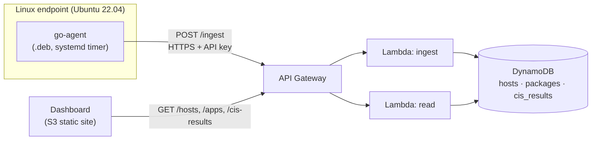
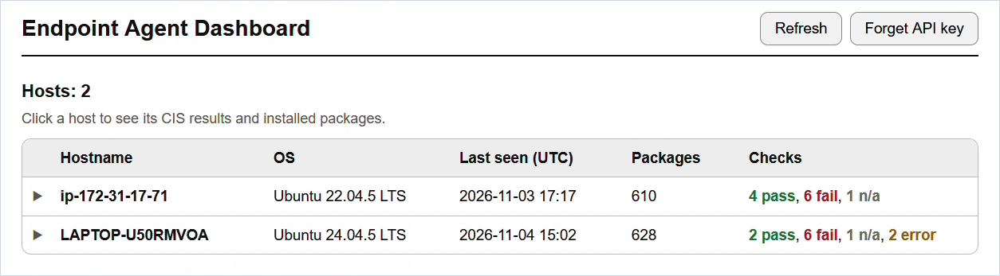
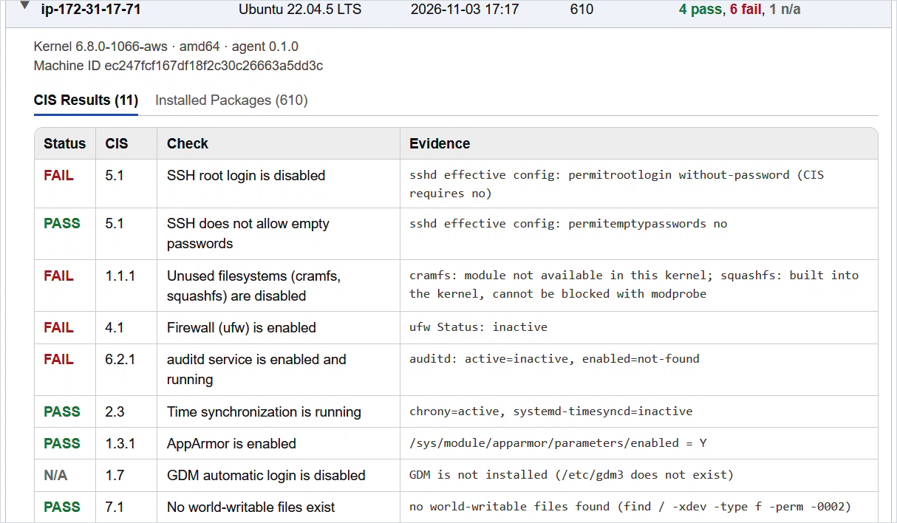
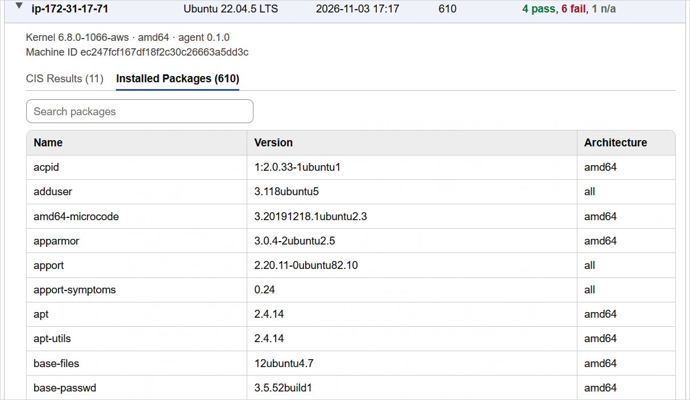

# Linux Endpoint Security Agent

A lightweight agent for Linux, written in Go. It lists the installed packages, runs CIS Benchmark configuration checks (Ubuntu 22.04, Level 1), and sends the results to an AWS backend. A web dashboard shows every host, its check results with evidence, and its packages.

## How it works



1. **Collect.** The agent reads the host details, lists installed packages with `dpkg-query`, and runs the CIS checks. Each check returns a status and the evidence it found.
2. **Send.** `go-agent send` posts one JSON report to `POST /ingest` over HTTPS, authenticated with an API key.
3. **Store.** The `ingest` Lambda saves the report in three DynamoDB tables, one item per host. Each run replaces the host's previous data.
4. **Read.** The `read` Lambda serves the data through `GET /hosts`, `GET /apps` and `GET /cis-results`.
5. **Display.** The dashboard asks for the API key once, lists the hosts, and loads a host's results and packages when you open it.

The agent is packaged as a `.deb`, so it installs like normal software, and a systemd timer runs it daily. It only reads the system and never changes it.

## Dashboard

Hosts at a glance, with a pass/fail summary per host. Click a host to expand it.



Each check shows its status, CIS section and the evidence the agent found (results from an Ubuntu 22.04 EC2 instance):



The installed packages of each host, with search:



## CIS checks

| Check | What it verifies |
|---|---|
| `ssh-root-login` | SSH root login is disabled |
| `ssh-empty-passwords` | SSH does not allow empty passwords |
| `unused-filesystems` | `cramfs` and `squashfs` are disabled |
| `firewall-enabled` | The firewall (`ufw`) is installed and active |
| `auditd-running` | `auditd` is enabled and running |
| `time-sync` | `chrony` or `systemd-timesyncd` is running |
| `apparmor-enabled` | AppArmor is enabled |
| `gdm-autologin` | GDM automatic login is off |
| `no-world-writable-files` | No world-writable files exist |
| `password-complexity` | A minimum password length and mix of characters is enforced |
| `password-expiration` | Passwords expire within 365 days |

Every check ends in one of four statuses:

| Status | Meaning |
|---|---|
| `PASS` | The setting meets the benchmark |
| `FAIL` | The setting does not meet the benchmark |
| `NOT_APPLICABLE` | The component is not installed (for example no desktop, so no GDM) |
| `ERROR` | The agent could not tell; the evidence says why |

## API

All routes need the `x-api-key` header; requests without a valid key get `403`.

| Method | Path | Description |
|---|---|---|
| `POST` | `/ingest` | Store an agent report (used by the agent) |
| `GET` | `/hosts` | List all hosts |
| `GET` | `/apps?machine_id=<id>` | Installed packages of one host |
| `GET` | `/cis-results` | CIS results of all hosts, or of one with `?machine_id=<id>` |

## Getting started

**Requirements:** Go 1.22+, Terraform, the AWS CLI configured for your account, and a Linux shell with `dpkg-deb`.

**1. Deploy the backend and dashboard**

```bash
cd infra
terraform init
terraform apply
terraform output -raw api_key      # the API key
```

Terraform also prints the API address (`api_url`) and the dashboard address (`frontend_url`).

**2. Build the package**

```bash
bash packaging/build-deb.sh        # creates dist/go-agent_0.1.0_amd64.deb
```

**3. Install and configure it on a Linux machine**

```bash
sudo apt install ./go-agent_0.1.0_amd64.deb
sudo tee /etc/go-agent/config.json >/dev/null <<EOF
{ "api_url": "<api_url>", "api_key": "<api_key>" }
EOF
sudo systemctl start go-agent.service      # send the first report now
```

The API key is never part of the code or the package; it only lives in this config file, which only root can read.

**4. Open the dashboard**

Open `frontend_url`, enter the API key, and select a host.

## Repository layout

```
agent/        Go agent (checks, package list, sender)
backend/      Lambda functions (ingest.py, read.py)
infra/        Terraform: DynamoDB, Lambda, API Gateway, S3 hosting
frontend/     Dashboard (index.html, app.js, style.css)
packaging/    .deb build script and systemd service/timer
docs/         Demo video and screenshots
```

## Known limitations

- The dashboard is served over plain HTTP (S3 website hosting). CloudFront would add HTTPS, but it needs a verified AWS account.
- One API key is shared by all agents and the dashboard. Per-agent keys and a login would be the next step.
- Only the latest report per host is kept, with no history.
- Works on Ubuntu (dpkg). RHEL (rpm) is not supported yet.

## License

Released under the [MIT License](LICENSE).
