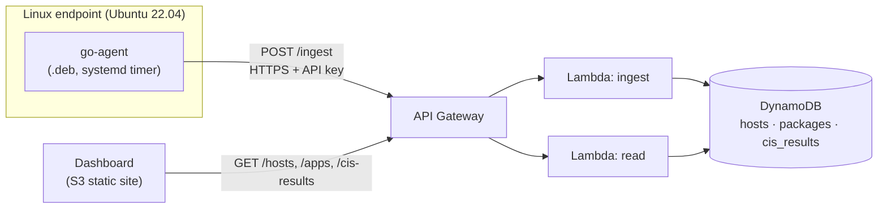

# Linux Endpoint Security Agent

A lightweight agent for Linux endpoints, written in Go. It inventories the installed packages, runs CIS Benchmark configuration checks, and reports the results to an AWS backend. A small web dashboard shows every host, its check results with evidence, and its packages.

- **Agent:** single static Go binary, distributed as a `.deb` package, runs daily from a systemd timer
- **Backend:** API Gateway, Lambda (Python) and DynamoDB, defined entirely in Terraform
- **Dashboard:** plain HTML, CSS and JavaScript, hosted on S3
- **Checks:** 11 checks mapped to the CIS Ubuntu Linux 22.04 LTS Benchmark (Level 1)

**Demo:** [download the dashboard walkthrough (mp4, 15 MB)](https://github.com/oneeka510-cmd/linux_security_agent/raw/main/docs/demo.mp4)

## How it works



1. **Collect.** The agent reads the host details, lists installed packages with `dpkg-query`, and runs the CIS checks. Each check returns a status and the evidence it found.
2. **Send.** `go-agent send` posts one JSON report to `POST /ingest` over HTTPS, authenticated with an API key. Network and server errors are retried; a rejected key is not.
3. **Store.** The `ingest` Lambda validates the report and writes one item per host to each of three DynamoDB tables. Each run replaces the host's previous data.
4. **Read.** The `read` Lambda serves the data through `GET /hosts`, `GET /apps` and `GET /cis-results`.
5. **Display.** The dashboard asks for the API key once, then lists hosts. Opening a host loads its CIS results and packages.

## What the agent reports

```jsonc
{
  "host": {
    "machine_id": "…",            // /etc/machine-id, unique per machine
    "hostname": "ip-172-31-17-71",
    "os_pretty_name": "Ubuntu 22.04.5 LTS",
    "kernel": "6.8.0-1066-aws",
    "architecture": "amd64",
    "agent_version": "0.1.0",
    "collected_at": "2026-11-03T17:17:57Z"
  },
  "packages": [{ "name": "openssh-server", "version": "1:8.9p1-3ubuntu0.13", "architecture": "amd64" }],
  "checks": [{
    "id": "firewall-enabled",
    "title": "Firewall (ufw) is enabled",
    "cis_section": "4.1",
    "status": "FAIL",
    "evidence": "ufw Status: inactive"
  }]
}
```

Every check ends in one of four statuses:

| Status | Meaning |
|---|---|
| `PASS` | The setting meets the benchmark |
| `FAIL` | The setting does not meet the benchmark |
| `NOT_APPLICABLE` | The component is not installed (for example GDM on a headless server) |
| `ERROR` | The agent could not determine the state; the evidence says why |

The agent is **read-only**: it never changes the system it inspects.

## CIS checks

Mapped to the CIS Ubuntu Linux 22.04 LTS Benchmark v3.0.0. Section numbers identify the benchmark chapter each check belongs to.

| Check | CIS section | What it verifies |
|---|---|---|
| `ssh-root-login` | 5.1 | `PermitRootLogin` is `no` in the effective `sshd` configuration |
| `ssh-empty-passwords` | 5.1 | `PermitEmptyPasswords` is `no` |
| `unused-filesystems` | 1.1.1 | `cramfs` and `squashfs` cannot be loaded and are not loaded |
| `firewall-enabled` | 4.1 | `ufw` is installed and active |
| `auditd-running` | 6.2.1 | `auditd` is enabled and running |
| `time-sync` | 2.3 | `chrony` or `systemd-timesyncd` is running |
| `apparmor-enabled` | 1.3.1 | AppArmor is enabled in the running kernel |
| `gdm-autologin` | 1.7 | GDM automatic login is not enabled |
| `no-world-writable-files` | 7.1 | No world-writable files on the root filesystem |
| `password-complexity` | 5.3.3.2 | `pam_pwquality` requires `minlen` ≥ 14 and sufficient character classes |
| `password-expiration` | 5.4.1.1 | `PASS_MAX_DAYS` is between 1 and 365 |

## API

All routes require the `x-api-key` header; requests without a valid key receive `403`.

| Method | Path | Description |
|---|---|---|
| `POST` | `/ingest` | Store an agent report (used by the agent) |
| `GET` | `/hosts` | List all hosts with summary counts |
| `GET` | `/apps?machine_id=<id>` | Installed packages of one host |
| `GET` | `/cis-results` | CIS results of all hosts, or of one host with `?machine_id=<id>` |

```bash
curl -H "x-api-key: $API_KEY" "$API_URL/hosts"
```

## Repository layout

```
agent/        Go agent (collection, checks, sender)
backend/      Lambda functions (ingest.py, read.py)
infra/        Terraform: DynamoDB, Lambda, IAM, API Gateway, S3 hosting
frontend/     Dashboard (index.html, app.js, style.css)
packaging/    .deb build script, systemd service and timer, maintainer scripts
docs/         Design notes and demo video
```

## Getting started

**Requirements:** Go 1.22+, Terraform 1.5+, the AWS CLI configured for an account and region, and a Debian-based Linux shell (for `dpkg-deb`) to build the package.

### 1. Deploy the backend and dashboard

```bash
cd infra
terraform init
terraform apply
```

Terraform prints `api_url` and `frontend_url`. The API key is a sensitive output:

```bash
terraform output -raw api_key
```

### 2. Build the package

```bash
bash packaging/build-deb.sh          # writes dist/go-agent_0.1.0_amd64.deb
```

### 3. Install and configure on an endpoint

```bash
sudo apt install ./go-agent_0.1.0_amd64.deb
sudo tee /etc/go-agent/config.json >/dev/null <<EOF
{ "api_url": "<api_url>", "api_key": "<api_key>" }
EOF
sudo systemctl start go-agent.service        # first report now
journalctl -u go-agent.service -n 5          # needs sudo unless you are in the adm group
```

The package enables a systemd timer that sends a report daily and five minutes after boot. The config file is readable by root only. `AGENT_API_URL` and `AGENT_API_KEY` environment variables override it.

The agent can also be run by hand (root is needed for some checks):

```bash
sudo go-agent checks      # print the CIS results as JSON
go-agent packages         # print the installed packages as JSON
sudo go-agent send        # collect everything and upload it
```

### 4. Open the dashboard

Open `frontend_url`, enter the API key, and select a host.

## Security notes

- The API key is never written into the code or the package. The package ships an empty config template with `0600` permissions.
- Each Lambda has its own IAM role with least privilege: `ingest` can only write to the three tables, `read` can only read from them.
- Data from endpoints is rendered in the dashboard as text, never as HTML.
- Terraform state contains the API key and account details; it is excluded from version control.

## Known limitations

- The dashboard is served over plain HTTP (S3 website hosting). CloudFront in front of a private bucket would add HTTPS but needs a verified AWS account.
- One API key is shared by all agents and by dashboard reads. Per-agent credentials and user sign-in are the next step.
- Only the latest report per host is stored, with no history.
- A DynamoDB item is limited to 400 KB, so a host with thousands of packages would need its package list split across items.
- The password complexity check is a simplified reading of the CIS controls and does not verify the PAM configuration.
- Checks target Ubuntu 22.04. The agent also runs on other dpkg-based systems, but the CIS mapping applies to 22.04 only.

## Roadmap

- HTTPS for the dashboard (CloudFront) and sign-in (for example Amazon Cognito)
- Per-agent credentials or signed requests
- Report history, trends, and alerts when a check changes from `PASS` to `FAIL`
- More CIS checks and PAM verification
- Publish the package in a private apt repository
- RPM packaging for RHEL 9

## License

Released under the [MIT License](LICENSE).
